<p align="center"></p>

# legalPrivacy

legalPrivacy makes believable background browsing, searches and DNS lookups from your
computer, so that bulk analysis of your traffic tells much less about you. It runs in a
real browser, behaves like a person, follows a daily rhythm, and can make optional Tor
`.onion` noise. Everything it does is visible in a local dashboard, and nothing about your
activity is stored after it stops.

> **Named after a blog.** legalPrivacy is named in homage to [*Legalizing Privacy*](https://legalizingprivacy.substack.com)
> by **Amy Peikoff**, "writing about why and how to legalize privacy, using the principles of private property and freedom
> of contract". Read it: [home](https://legalizingprivacy.substack.com) · [about](https://legalizingprivacy.substack.com/about) ·
> [archive](https://legalizingprivacy.substack.com/archive).

This project was called noisyCricket until v2.9;
existing settings, start-up commands (`cricket`, `cricket-launch`) and `CRICKET_*` environment variables keep working.

<p align="center">
  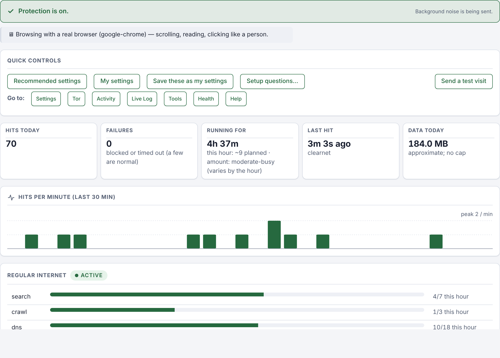
  <br><sub>The <b>Dashboard</b>: is it on, how much it did today, and the last half hour minute by minute (all screenshots use made-up example data).</sub>
</p>

### The graphs

<p align="center">
  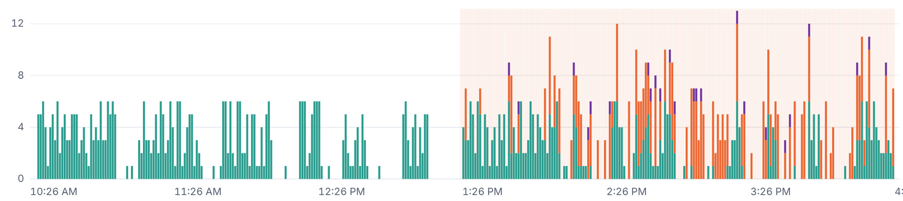
  <br><sub><b>Proof, last 6 hours:</b> your traffic (teal), the noise (green) and Tor (purple), minute by minute. The shaded part is when the noise was on.</sub>
</p>

<p align="center">
  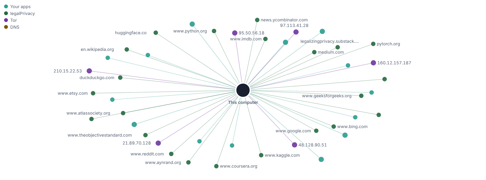
  <br><sub><b>Proof, live map:</b> every machine this computer is talking to right now, and whose traffic it is.</sub>
</p>

| | |
|---|---|
| 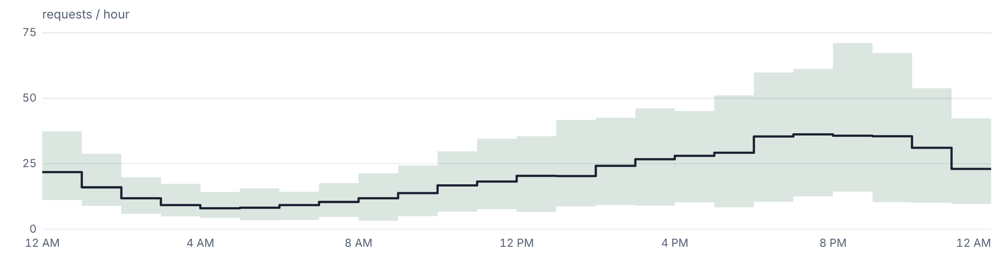<br><sub><b>The plan:</b> how much noise to expect at each hour of the day, with the usual range.</sub> | 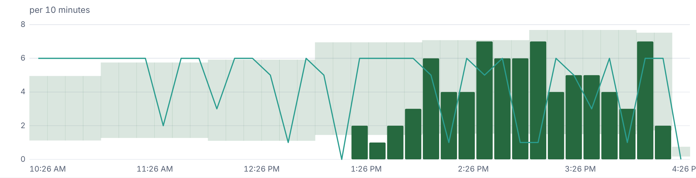<br><sub><b>This session vs the plan:</b> green bars stayed inside the planned range; red would mean off plan.</sub> |
| 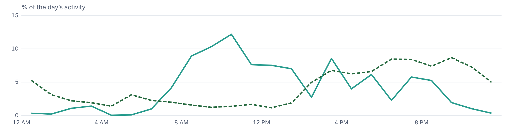<br><sub><b>You vs the noise:</b> when your activity happens, against when the noise's does.</sub> | 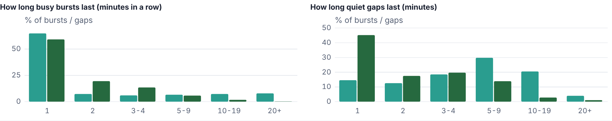<br><sub><b>Bursts and gaps:</b> how long busy spells and pauses last, yours against the noise's.</sub> |
| 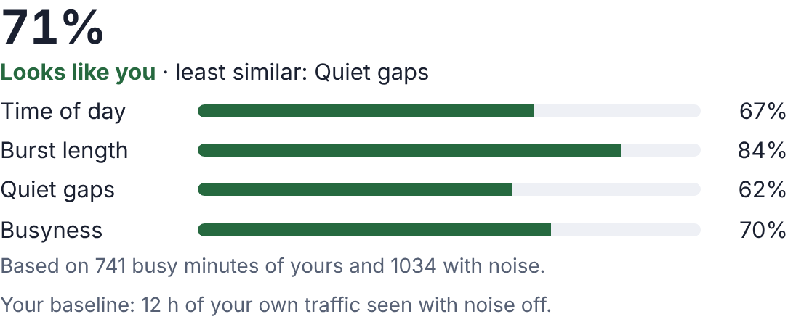<br><sub><b>Does it look like you?</b> A score and four checks.</sub> | 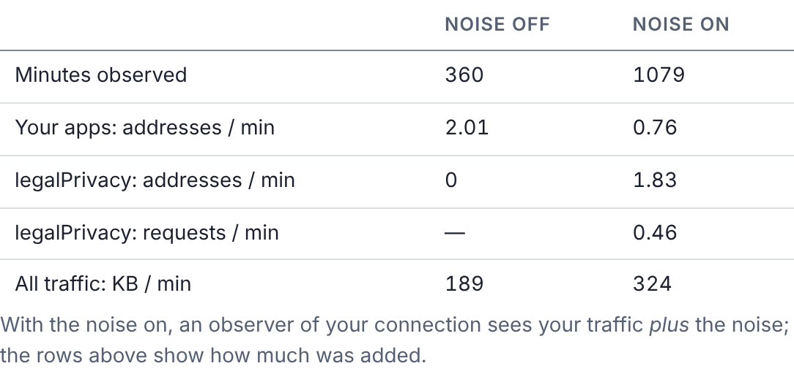<br><sub><b>Off vs on:</b> what an observer sees with and without the noise.</sub> |
| 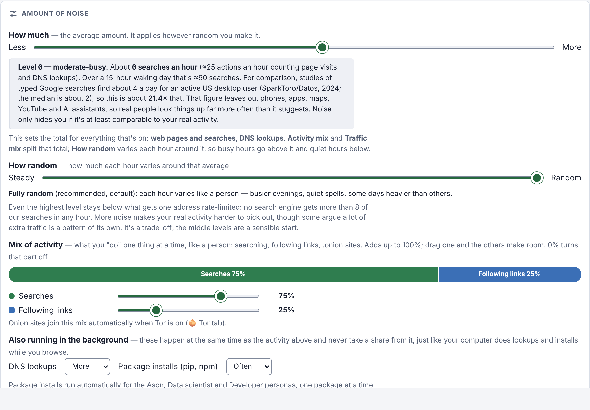<br><sub>How much noise, how random, and the mix</sub> | 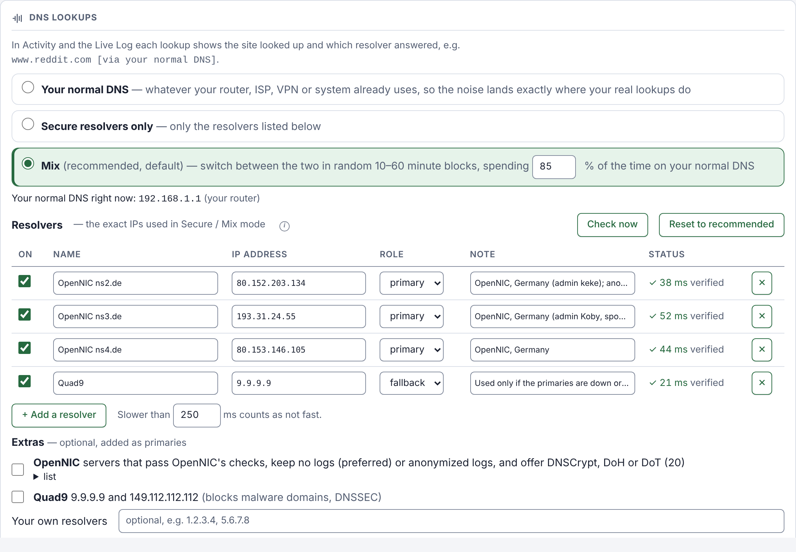<br><sub>DNS: your resolvers, checked live</sub> |
| 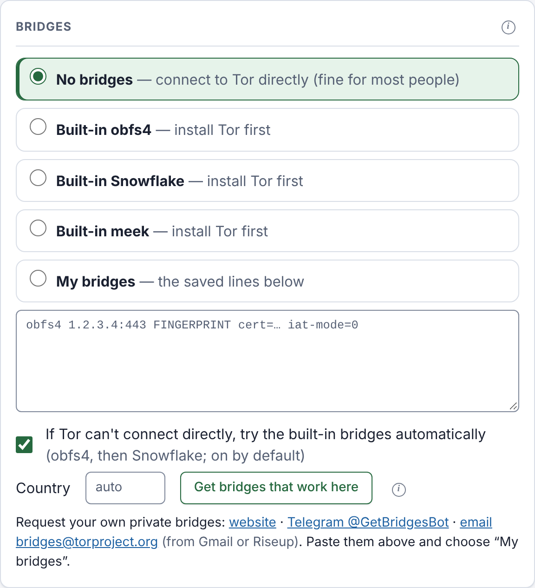<br><sub>Tor bridges</sub> | |

### Newer features

| | |
|---|---|
| 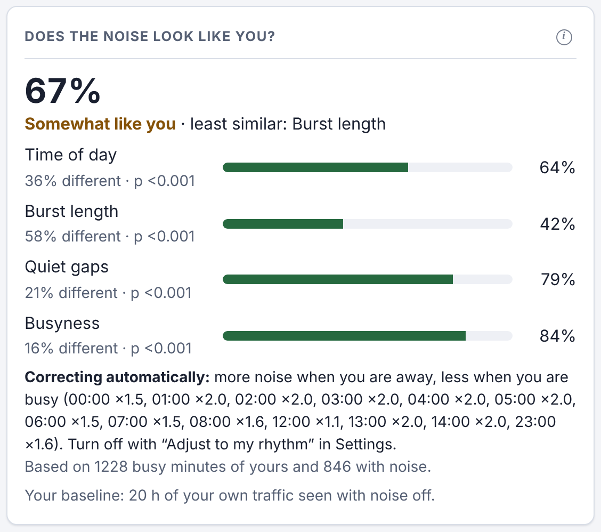<br><sub>Proof: each rhythm comparison shows percent different and a p-value, and "Adjust to my rhythm" lists the hours it is changing. (Demo data.)</sub> | 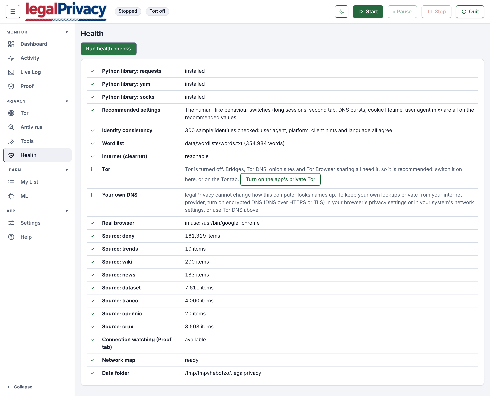<br><sub>Health: recommended settings, identity consistency and one-click fixes.</sub> |
| 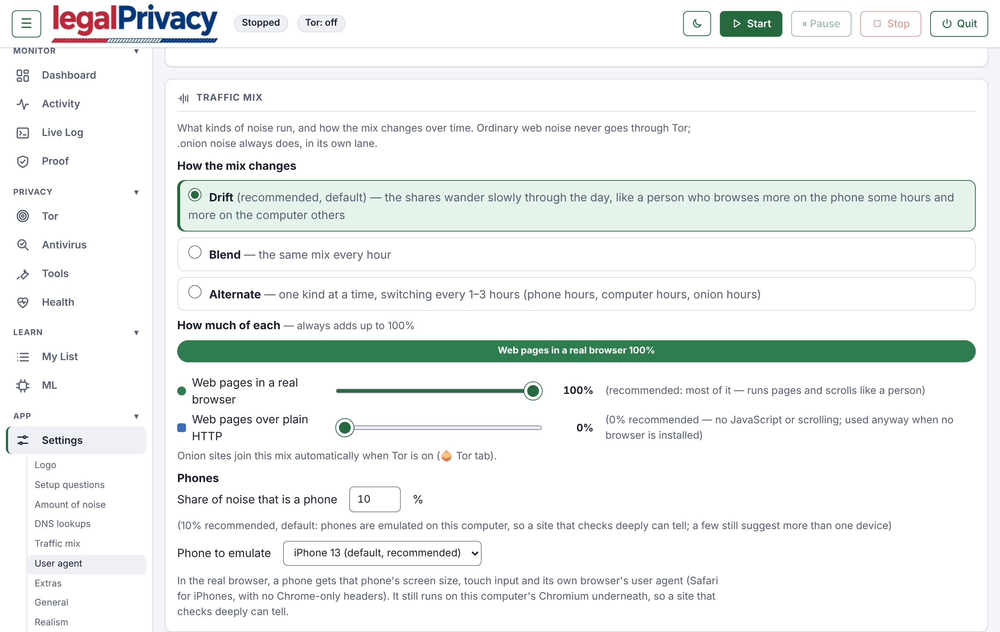<br><sub>Side menu: a tab's cards are listed under it; ☰ hides the menu, Collapse keeps the icons.</sub> | 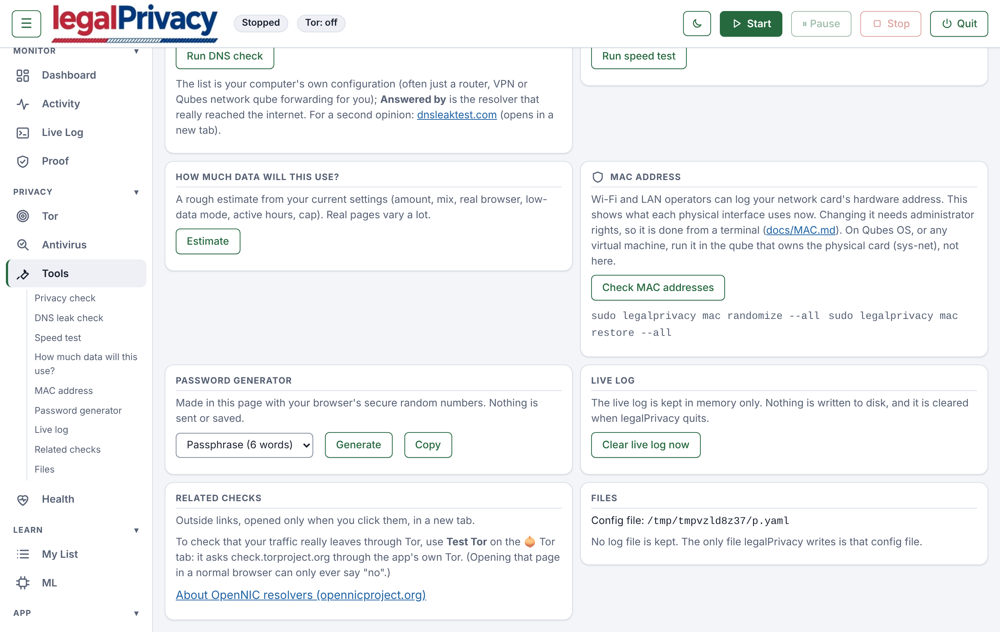<br><sub>Tools in two compact columns, with a password generator.</sub> |
| 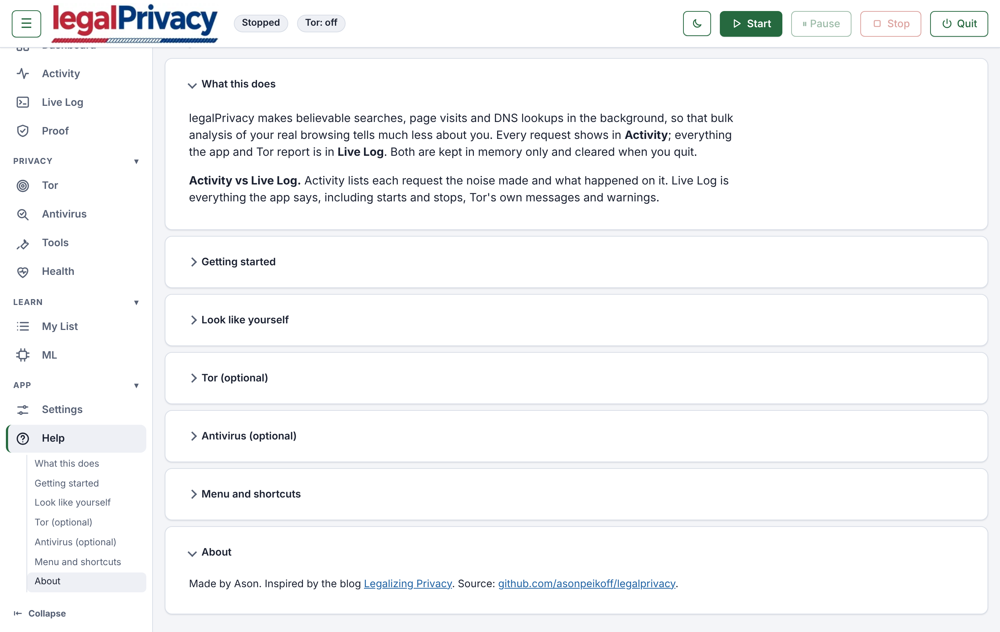<br><sub>Help as expandable sections, About included.</sub> | 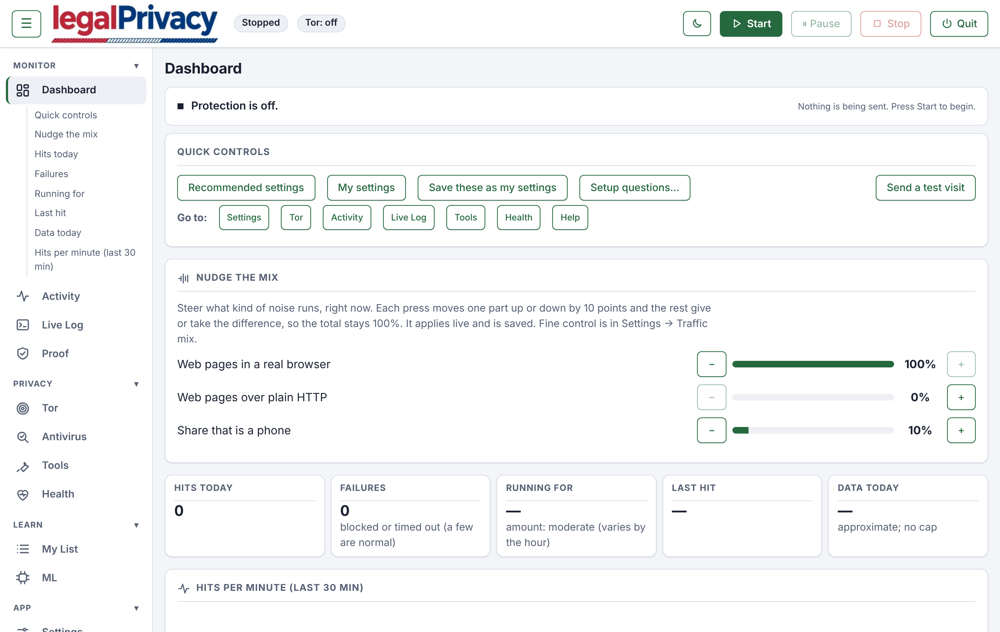<br><sub>The dashboard with the red, white and blue logo and the grouped menu.</sub> |


## Quick start

| You have | Do this |
|---|---|
| A release download (Linux for now) | `chmod +x legalprivacy-launch-linux`, then run it. Windows and macOS downloads are still under development (see below). |
| The source (Python 3.10+) | Double-click `Start-legalPrivacy.bat` (Windows) or `start-legalprivacy.command` (macOS/Linux). The first run sets up a private environment. |
| pip | `pip install .` then `legalprivacy-launch` (or `python -m legalprivacy`) |
| Docker | `docker compose up -d`, then `docker compose logs legalprivacy` for the dashboard link. See [docs/DOCKER.md](docs/DOCKER.md). |

**It browses with your own Firefox.** By default the noise browser is the Firefox installed on your computer, started on a
private *copy* of your profile: your settings, add-ons and bookmarks, so it looks like your browser. Logins, cookies and the
list of pages you visited are never copied, your real profile is only read, and the copy is deleted when the browser closes.
This uses Selenium and geckodriver (installed with the app); Firefox from Snap or Flatpak can't be driven, so there it falls
back to the app's own browsers (the Live Log says why).

**Run it as a background service (Linux).** `./start-legalprivacy.sh --service` installs a systemd user service that
starts when you log in and keeps legalPrivacy running with no window. The dashboard is still the same web page: run
`./start-legalprivacy.sh --url` to print its link, and `./start-legalprivacy.sh --uninstall-service` to remove the service.
Check on it with `systemctl --user status legalprivacy` and `journalctl --user -u legalprivacy -f`. The first time, open the
dashboard once to answer the three setup questions; after that it starts noise by itself.

> **Windows and macOS:** ready-made downloads are still under development and are not being built right now; we are leaving them for later. The source launchers (`Start-legalPrivacy.bat`, `start-legalprivacy.command`) and `pip install` are kept and still work from source. The build setup for both is kept, commented out, in `.github/workflows/release.yml`.

Your browser opens the dashboard. The first run asks three questions (how much noise, whether
to add Tor `.onion` noise, whether to start automatically) and then starts. Every other setting
already has the recommended value, and settings save themselves as you change them.

## Dashboard

| Tab | What it's for |
|---|---|
| **Dashboard** | Hits, failures, uptime, data used today, hits per minute, a test hit |
| **Activity** | Every request: time, lane, engine, address, what the browser did (scrolls, depth, time on page, clicks, downloads), result, load time. A "Now" line shows the visit in progress. Download as CSV or JSON. |
| **Live Log** | Everything the app and Tor report, with level and source filters and search. Kept in memory only and cleared when the app quits. |
| **🧅 Tor** | Tor status and progress, Start / Stop / Restart / New identity / Install, live circuits, Tor's own log, onion sites, bridges |
| **Settings** | Amount and randomness, mix of activity, DNS, traffic mix and phones, user agent, extras, realism |
| **Health** | Plain-language self-checks |
| **Help** | What each part does |
| **My List** | Your own sites, which the noise visits most (see below) |
| **ML** | How easily your traffic can be told apart from the noise (see below) |
| **Tools** | Data-use estimate, privacy check, DNS leak check, speed test, clear the live log |
| **Proof** | A live EtherApe-style map of every machine this computer talks to, 6 hours of traffic per minute with the noise on/off periods shaded, and whether the noise's rhythm looks like yours |

**Nudge the mix.** The Dashboard tab has a "Nudge the mix" card: minus and plus buttons for web pages in a real browser,
web pages over plain HTTP, Tor .onion sites (when Tor is on) and the phone share. Each press moves one part by 10 points,
the others give or take the difference so the total stays 100%, and the change is saved and applied live. Fine control
stays in Settings → Traffic mix.

<p align="center">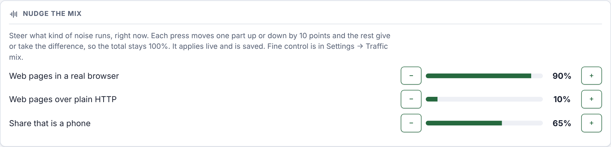</p>

The dashboard listens only on `127.0.0.1` and needs the token in its link. Settings live in
`~/.legalprivacy/config.yaml` (`%APPDATA%\legalPrivacy` on Windows); set `LEGALPRIVACY_HOME` to move them.

## How much, and when

- **How much** (1–10) is the average amount of everything that's on: web pages and searches,
  DNS lookups, and `.onion` sites when Tor is on.
- **How random** sets how much each hour varies around that average: 0% is the same every hour;
  100% (the default) varies like a person, with busier evenings, quiet spells and some days
  heavier than others. Anything in between is partly each.
- **Activity mix** and **Traffic mix** are bars that always add up to 100%: they split the total
  between searches, following links and DNS, and between a real browser, plain HTTP and `.onion` sites.

| Level | Searches an hour | Over a 15-hour day |
|---|---|---|
| 1 | 1 | ~15 |
| 3 | 4 | ~60 |
| 5 (default) | 11 | ~165 |
| 7 | 25 | ~375 |
| 9 | 50 | ~750 |
| 10 | 70 | ~1050 |

These are averages: in random mode busy hours go well above them. No search engine gets more than
20 searches an hour from legalPrivacy; above that the searches spread over more engines. Page visits
and DNS lookups come on top of searches.

Activity comes in **sittings**: a few requests close together, then a longer gap, the way people
use a computer. The first action comes within seconds of pressing Start.

## Behaving like a person

When Chrome, Edge, Brave or Chromium is installed, legalPrivacy drives it in the background
(the window is hidden by default; you can also show it, or keep a real window off-screen).

- **Time on a page** is mostly short, with a long, rare tail: 1 in 25 visits last a minute or
  more, 1 in 100 three minutes or more, 1 in 500 ten minutes or more. Long visits keep moving:
  slow scrolls, glances back up, the mouse wandering.
- **Reading:** scrolling in eased bursts, pauses to read, scrolling back up, re-reading,
  hovering, now and then highlighting a line of text.
- **Search results pages:** a quick glance; or a look, half a screen down and a longer pause;
  or one smooth scroll and a stop. The top result is clicked about half the time.
- **Clicks** follow curved mouse paths, or taps on phones.
- **Now and then** a linked document is downloaded or an image saved, through the browser, and
  discarded.
- **Pages that need an account** (Facebook, Instagram, LinkedIn, X and the like): public pages are
  browsed normally. When a page asks to log in, the noise does what a logged-out person does: a
  short look, then somewhere else, and that site rests for a few hours. It never logs in.
- **Phones:** 55% of noise identities are phones, an **iPhone 13 with Safari** by default (or
  iPhone 15, iPhone SE, Pixel 7, Galaxy S24, or a mix), with the phone's screen and touch input.
- **Browser engine:** matches your own browser by default. If you use Firefox and Playwright's
  Firefox is installed (`python -m playwright install firefox`), the noise uses Firefox too.

### Cookies

Cookies are a trade-off: they're how sites track visitors, but a browser that never keeps any looks
like a brand-new visitor every time and gets far more "are you a robot?" checks. legalPrivacy keeps
**its own** cookies (never your browser's) for **about an hour** by default, then starts fresh. Each
set lives 60–140% of that time, so the resets don't happen on a fixed beat. Settings → Realism offers
"don't keep", 1 hour, 6 hours, 1 day, 1 week or 30 days, and the variation can be turned off.

### User agent

By default the noise uses **your own browser's user agent**, read automatically from your
installed browser, so it looks like you. Until it's known, it rotates. Settings → User agent also
offers random rotation (every hour or day) or one fixed entry, and lists the whole library:
Chrome, Chromium, Firefox (including ESR) and iPhone Safari releases from the last two years.

### Where searches and sites come from

| Source | What it is |
|---|---|
| Live trends | Google Trends, Wikipedia's most-read articles, BBC headlines |
| Real past searches | A random sample of real queries (MS MARCO, GooAQ) |
| Built-in topics, dictionary words | A small minority, and the offline fallback |
| Popular sites | The Tranco list, re-ranked by what real Chrome users load most (CrUX) |
| My List | Your own sites, when turned on |
| Interests | A few steady themes at a time, when turned on |

These lists ship with the app, so it never contacts those services for you unless you ask it to
refresh them (Settings → Realism).

**Safety filter.** Searches and sites are screened so the noise never visits anything
embarrassing or risky to have on your connection: adult, gambling, weapons, drugs, violence,
self-harm, hacking and government sites are blocked by word, by known-bad host lists and by
name patterns.

## My List

Your own sites. When it's on, most visits and DNS lookups come from them, with a share of other
sites mixed in (30% by default). Add them by hand (paste as many as you like), or find them:

- **Scan your browser history** (Chrome, Edge, Brave, Chromium, Firefox), read on this computer only
- **Import bookmarks** from your browsers
- **Import a file**: a bookmarks export (.html), a network log (.har: press F12, open the Network
  tab, browse a while, then "Export HAR"), Google Takeout history (`BrowserHistory.json`), or any
  list of addresses
- **Record** for 12, 24 or 48 hours: it counts only visits inside that window

Only site names and visit counts are read. You approve every site and choose how often each is
visited.

## ML: can your traffic be told apart from the noise?

The ML tab compares your real browsing (your browsers' history, read on this computer only) with
the noise, using only what your ISP or DNS provider could see: hour, weekday, rhythm, how popular
each site is, revisits and domain endings. A classifier tries to separate them, and you get:

- the **ROC AUC** (50% = can't tell them apart, 100% = trivial) with a 95% interval and per-fold scores
- the ROC curve, confusion matrix, accuracy, precision, recall, F1 and log loss
- which signals give the noise away, the specific values behind them, and the setting that fixes each
- when you browse versus when the noise runs, hour by hour
- a score history, an optional daily automatic run, and a quick "would this look like noise?" check
- **a stronger observer**: it also sees bursts, same-site runs and combinations of signals, is trained on the past and
  tested on the future, and is judged on how much noise it catches while rarely accusing you (at 1% and 0.1% false
  alarms), plus how often a flagged event would really be noise if only 1 in 100 events were
- **Try the demo**: compares the noise your current settings would make with a built-in, made-up typical person, so you
  can see what the tab shows before you have any history to use. A banner says it is not your history, and a demo score
  is never added to your score trend.

<p align="center">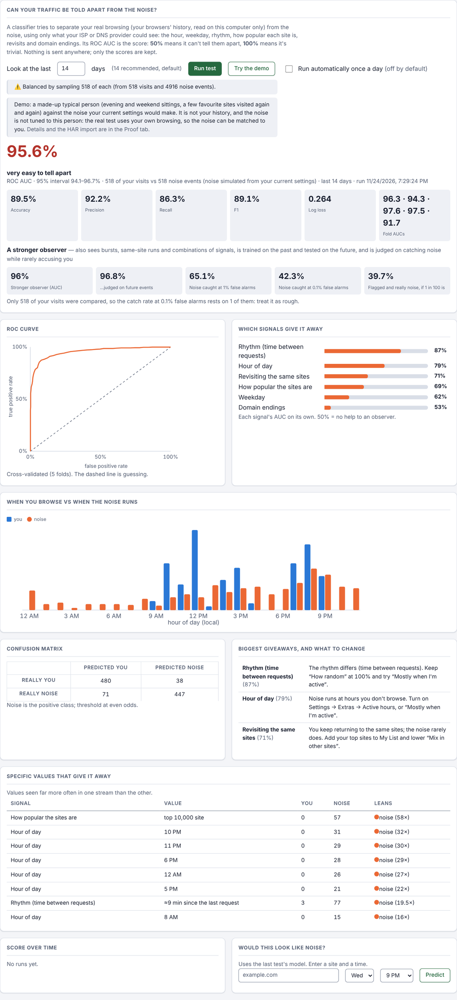</p>

Nothing is sent anywhere; only the scores are kept.

## Proof: is it working, and does it look like you?

The **Proof** tab watches which addresses this computer is connected to, every 5 seconds,
and sorts each connection by the program that owns it: **your apps**, **legalPrivacy**
(including the browser it drives) or **Tor**. Nothing is captured or read and no
addresses are looked up. Your own connections are never named or saved; only
per-minute counts are kept, for 7 days, on this computer.

- **Live network map** (like EtherApe): a bubble per remote machine, colored by owner. Noise sites are named.
- **Last 6 hours:** connections per minute, split by owner, with the minutes the noise was on shaded.
  Stop the noise for a while, start it again, and the difference is visible.
- **Off vs on:** how much the noise adds per minute.
- **Does the noise look like you?** Compares the noise with your own traffic from the
  minutes the noise was off: time of day, length of busy bursts, length of quiet gaps,
  busyness of a busy minute. Each is a 0–100% similarity (1 − Kolmogorov–Smirnov distance).
  It needs about an hour of your own activity with the noise off before it can judge.
  The **ML** tab is the stronger test.

On macOS, other programs' connections are only visible when legalPrivacy runs as
administrator; otherwise the tab shows the noise only and says so. The watcher can be
switched off on the tab.

### Activity graphs and importing a browser recording

Below the comparison, the Proof tab has three graphs, each with a one-line verdict:

1. **Intended pattern** (reference only): expected requests per hour of the day for your current
   settings. It is not a mock-up: it comes from the same rate planner the noise uses (`rate.py`:
   level, random or steady, how random) run over many simulated days, with hours outside
   *Active hours* set to zero. The band is the 10th to 90th percentile, the line the median. The
   persona changes which sites are visited, not how many or when.
2. **This session, actual vs intended:** what the noise really did in each 10 minutes over the last
   6 hours, drawn over the planned band. Whole hours well above or below the plan are red, and the
   verdict names them ("busier than planned between 02:00 and 04:00").
3. **Your baseline vs the noise:** your share of activity by hour of day next to the noise's, plus
   how long your busy bursts and quiet gaps last compared with the noise's.

**Where "how you browse" comes from.** Browser history can be old, and legalPrivacy has tools that
erase it, so it is never assumed. Your baseline is the first of these with enough data:

1. a **browser recording (HAR file)** you import;
2. minutes the traffic observer saw with the noise **off**;
3. your **browser history**, if present.

The Proof and ML tabs say which one is used and how much there is ("2 h from your HAR file",
"12 days of browser history"). With none, they show "not enough data" and how to provide some,
rather than a misleading score.

**Importing a recording.** Open your browser's developer tools, go to the **Network** tab, keep it
recording while you browse as usual, then **Save all as HAR** (Export). Choose that file in the
Proof tab (Chrome, Edge and Firefox files both work; up to 50 MB and 500,000 requests). A HAR file can
contain cookies, headers and page contents, so only each request's **time** and **site name** are
read, in memory; the file is not kept, and addresses, paths, query strings, headers, cookies and
contents are never stored or logged. What is saved (`har.json` in the app folder) is requests and
different sites per minute, plus a list of site names with counts that you can delete separately
("Delete site list") or together with everything else ("Forget imported data"). Panic (hard)
removes it too. The ML test can use a recording of at least 2 hours; it rebuilds approximate visits
from the saved counts and site names, so revisit habits are approximate.

## Is it working? (leak check and panic)

- **Proof tab → "Is it working?"** shows each check as *what you want to see*, *what we saw* and a plain verdict:
  ✓ working, ✗ not working (with what to do), ℹ for your information, ? not tested yet. It checks that noise is on,
  that your DNS choice isn't being redirected by your network, that Tor is connected (and, when Tor is on, that a test request really goes out through Tor from a
  different address than yours), and that the noise runs in a real browser that looks like yours. Nothing changes your settings.
- **Settings → Panic**: stop now; or also clear the log, the noise browser's cookies and any signed-in account sessions
  (see "Signed-in accounts"; you would have to sign in again); or also stop Tor and delete what legalPrivacy recorded
  about connections. Your settings are never deleted.

## Signed-in accounts (optional, off by default)

**Settings → Accounts** lets the noise browser also browse while signed in to **your own** Google and Microsoft
(Outlook) accounts, so the noise looks like a logged-in person.

- **You sign in by hand.** "Sign in" opens a normal, visible browser window on your computer at the provider's sign-in
  page. You type your password and any code there. legalPrivacy never sees, stores or types a password or code. When
  you close the window (or your inbox appears) the browser's session (cookies) is saved in legalPrivacy's own folder
  (`accounts/`, owner-only permissions) and nothing else. It needs a computer with a screen. "Forget" deletes it.
  This is not an import: legalPrivacy never reads cookies from your everyday browser.
- **Off by default, per account.** Nothing signed-in runs unless the account is signed in, its switch is on and the
  noise is running. Each account has an hourly cap (default 3, 1-10) and a daily cap, and the visits are spaced at random.
- **Read-only.** A signed-in visit only loads and scrolls one allowed page: Google: a search on google.com, the Gmail
  inbox, YouTube; Microsoft: the Outlook inbox or calendar (outlook.live.com / outlook.office.com), Bing, microsoft.com.
  It never clicks (every click is cancelled in the page), never opens a message, and never sends, deletes, archives,
  labels, marks read/unread, replies, forwards, composes, accepts or declines, signs out or changes a setting.
- **Never over Tor.** These visits use the ordinary clearnet browser only. A Tor-looking proxy is refused.
- **Separate cookies.** The account's session is never given to the ordinary noise browser, and the noise browser's
  cookie clean-up never touches it. Panic (medium and hard) deletes the accounts folder.
- **Pauses.** "429" means the site answered "too many requests, slow down"; a robot-check page is the site asking
  whether you are a person. Either one (or finding itself on a sign-in page) pauses that account's signed-in visits for a
  random while: 3-12 hours the first time, 12-36 hours if it happens again within 3 days, 1-4 days if it keeps happening
  within a week. The dashboard shows "Paused until about ..." with a "Resume now" button, and the Live Log says why. The
  ordinary signed-out noise carries on exactly as before. Per account you can choose "Keep going" after a robot check or
  429 instead (not recommended); a dead session still pauses.
- **Please be aware:** these are your real accounts. The searches and visits become part of that account's history and
  affect its ads and recommendations, and Google or Microsoft may ask you to verify, or restrict, an account that looks
  automated. A spare account is safer. Nothing is ever sent, deleted or changed in the mailbox. Google sometimes refuses
  sign-in in an automated browser; if so, the account simply can't be used.

## Antivirus (ClamAV), offline-first

An optional **Security** tab (web and native app) manages the ClamAV you install yourself. legalPrivacy never bundles ClamAV (it is GPL); it only runs your `clamscan`, `freshclam` and `sigtool`, found on `PATH` or in the usual Windows, macOS and Homebrew folders, and shows the install hint for your system when they are missing.

**What contacts the internet.** Per [docs.clamav.net](https://docs.clamav.net/), only `freshclam`, the signature updater, does: a DNS TXT lookup of `current.cvd.clamav.net`, then an HTTPS download from `database.clamav.net`. Nothing documented says `clamscan` connects anywhere, and this feature does not assume that: it proves it.

**How it is prevented.**
- Signatures live in an app-owned folder (`<app folder>/av/db`). Scans always run `clamscan --database=<that folder> --recursive --infected`, so the system's ClamAV configuration is never read or changed. `clamdscan` is detected but never used.
- `freshclam` is never run on a schedule, as a daemon, or by a scan, detect, state or import. It runs only from the **Update signatures (contacts ClamAV's servers)** button, after a confirmation that names exactly what is contacted, with a generated minimal config (`--config-file`, `--datadir`). If you would rather stay fully offline, **Import** `main`/`daily`/`bytecode` `.cvd`/`.cld` files you downloaded elsewhere: each is checked (`sigtool --info` must report a valid digital signature, and `clamscan` must load it) in a private copy before it enters the folder; failures are rejected.
- On Linux the scanner runs with its network removed: `unshare --net`, else `unshare -rn` (no root needed), else `firejail --net=none`. A one-time probe checks that the method really leaves only the loopback interface, caches the result, and the tab says which is active.
- Network is not removed on Windows and macOS (no unprivileged way); there the tab says "Detection only".

**How it is proven (every OS).** The scanner's whole process tree is watched with psutil about every 100 ms for any non-loopback connection or DNS lookup helper. Each result records "scanner connections: N". If N is more than 0 the scan is marked **NOT OFFLINE**, the scanner is killed and a warning is logged. The Proof tab's "Is it working?" list gets an "Antivirus scanner stays offline" row (want: 0 connections during scans), shown once you have used the tab. The **EICAR self-test** button builds the harmless standard test string at runtime from parts (it is never written whole in this repository, which would make antivirus tools flag it), scans it with the app's signatures, and deletes the file; your own antivirus may react to it.

**Your files.** A scan never deletes, moves or changes anything. Each result has "Copy path" and an explicit per-file "Quarantine" (confirmation; the file goes to `<app folder>/av/quarantine`, can be restored, or deleted permanently). Panic (hard) deletes the quarantine and scan results, not your own files or the signature files.

**Not verified.** Tested here with stub programs on Linux, not with real ClamAV signatures or a real `freshclam` run. The Windows and macOS code paths (tool locations, process watching, `firejail`) are untested on those systems. Without network removal the watcher can miss a connection that opens and closes between two looks; for a hard guarantee also block `clamscan` in your firewall. The Debian/Ubuntu `clamav` package may install its own background updater service; legalPrivacy does not touch it (the tab notes when a `freshclam` process is running).

## Native desktop app

`legalprivacy-gui` (or `python -m legalprivacy.gui`) opens a real desktop window: no browser, no web view and no
network port. It uses Tk, which ships with Python on Windows and macOS (on Debian/Ubuntu install it with
`sudo apt install python3-tk`; on Fedora `sudo dnf install python3-tkinter`), so nothing extra is installed with pip.
If Tk is missing it says so and opens the web dashboard instead.

- **Header:** Start / Pause / Stop (F5 / F6 / F7), a status light, a Tor chip and a "settings in effect" chip.
- **Dashboard:** hits, failures, uptime, last hit and data today; a hits-per-minute sparkline; the lanes with their
  budgets; **how much noise** (the 1-10 level and the steady-to-random slider); the **mix of activity** and the
  **traffic mix** as coloured stacked bars with one slider per part that always add up to 100% (drag one and the others
  make room; 0% turns a part off), the drift/blend/alternate pattern, and the phone share and device.
- **Nudge the mix** (Dashboard): the same minus and plus buttons as the web dashboard, applied live.

<p align="center">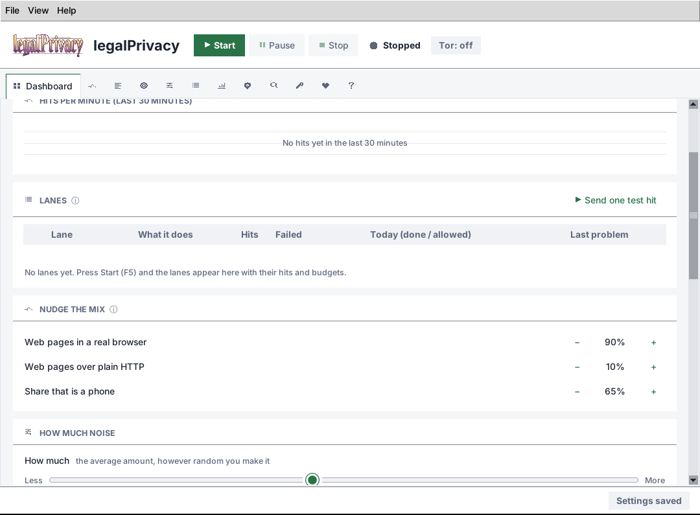</p>

- **Activity:** recent hits, newest first (site names only), with filters and CSV/JSON export. **Live Log:** coloured by
  level, filter, pause scrolling, copy, clear.
- **Tor:** status and progress, details, Start / Stop / Restart / New identity / Install / Test, the circuits table,
  the onion seed editor (with Reset), bridges (modes, your own lines, auto-fallback, Get bridges for my country) and the
  Tor log.
- **Settings:** DNS (modes, the resolver table with the per-server verdicts, OpenNIC / Quad9 / your own), user agent,
  active hours, typos / polite / low-data and the other extras, persona, interests, household, your own activity,
  search-engine weights, the real-browser and cookie settings, query sources and their freshness, signed-in accounts,
  general settings and the three Panic buttons (each asks first).
- **My List** (your sites and how often, find them from history, bookmarks, a file or a recording), **ML** (the "can your
  traffic be told apart" test with ROC curve, signals, giveaways and predictor), **Proof** (the "is it working?"
  checks, the three activity graphs, the 6-hour connection timeline, on/off comparison, address trace, HAR import and
  where your baseline comes from), **Tools** (data estimate, privacy check, DNS leak check, speed test), **Health** and
  **Help**.
- Only the animated network map needs a web view; there is an "Open in the web dashboard" button for it.

Changes to any setting save and go live by themselves about a second after you stop editing, and the header
chip confirms they are in effect. Tooltips explain the less obvious controls, Ctrl+1 to Ctrl+9 jump between tabs, and
View → Dark mode switches the look (both themes use the web dashboard's colours). The web dashboard stays as the
backup: File → "Open the web dashboard (backup)". Closing the window stops the noise and Tor. If a dashboard is
already running, a second copy offers to open that one instead.

## Desktop window (optional, web view)

Prefer an app window to a browser tab? `pip install "legalprivacy[desktop]"` then run `legalprivacy-desktop`.
It shows the same dashboard in its own window (using your system's web view: Edge WebView2 on Windows, WebKit on macOS
and GTK/Qt WebKit on Linux), and closing the window quits the app. If the extra isn't installed it opens the normal
browser dashboard instead. This is a first step; links to other websites may open inside the window.

## DNS

**When some of your DNS servers can't be trusted.** Each time the servers are checked, legalPrivacy also tests whether they are honest:
a made-up name under `.invalid` must not exist (a server that answers it is hijacking missing names), and the servers must agree with
each other about the same well-known names (a server that repeatedly disagrees is taken out of use). If the servers split evenly about
a name, nobody can be told apart, so they are marked "servers disagree" and used less. No single server answers more than about half
of the noise lookups. This covers the DNS noise on your normal connection. The Tor lane visits only `.onion` sites, which need no DNS at all.

| Setting | What it does |
|---|---|
| **Mix** (default) | Switches between your normal DNS and the secure resolvers in random 10–60 minute blocks, half the time each (adjustable) |
| **Your normal DNS** | Your computer's own resolver: router, ISP, VPN or your system's encrypted DNS |
| **Secure resolvers only** | Only the resolvers in the list in Settings. By default: OpenNIC ns2.de `80.152.203.134`, ns3.de `193.31.24.55` and ns4.de `80.153.146.105` as primaries, and Quad9 `9.9.9.9` as a fallback used only when they're down or slower than 250 ms. Every row is editable; extras: the whole OpenNIC directory, Quad9's pair, your own IPs. |

Each lookup in Activity shows which resolver answered it. **Check now** times each resolver and asks it for `whoami.akamai.net`, which reveals the machine that really answered. If something on your network secretly answers in their place (some ISPs, workplaces, hotels and cloud hosts do), the list says **⚠ intercepted**.

## Extras (Settings)

All optional:

- **Active hours:** only make noise between set times
- **Look sites up like a browser, and follow lookups with a page's burst of lookups:** a browser also asks for IPv6 and
  HTTPS records, and a real page load asks for its fonts, scripts and other sites a few tens of milliseconds after the
  site itself. With the second option on (the default), about 85% of DNS noise lookups are followed by such a burst
  (usually 3 or 4 names), using real names only
- **Your own activity:** pause while you're using the connection, or run mostly while you're active
- **Persona:** who the noise mostly looks like (Data scientist by default, Developer, Sports fan, Student, Home
  cook and gardener, Traveller, or neutral), followed mostly but not perfectly (90% by default). Searches are mostly
  real people's searches on the theme; popular sites on the theme come up more often
- **Package installs:** real `pip` (and `npm`) installs, downloads and uninstalls of popular packages, in
  legalPrivacy's own separate environment, removed again afterwards. On automatically for the Data scientist and
  Developer personas
- **Interests:** a few steady themes at a time, changing every so often
- **Household:** noise from 2–5 virtual people with their own devices, browsers and hours
- **Search engines:** how often each is used
- **More typos** in searches, **polite mode** (no site twice within a minute), **low-data mode**,
  a **daily data cap**, **Prometheus metrics** at `/metrics`
- **Browser-like DNS** (on by default): also asks for IPv6 and HTTPS records

## Tor (optional)

**Bridges** (Tor tab), for networks that block Tor:
- **Built-in obfs4, Snowflake or meek:** taken from the official Tor bundle's own list, so they stay current with each Tor update.
- **My bridges:** your saved lines.
- **Automatic** (on by default): if Tor can't connect directly within about a minute, it tries the built-in obfs4 bridges, then Snowflake, like Tor Browser's Connection Assist.
- **Get bridges that work here:** asks the Tor Project's bridge service (bridges.torproject.org) for your country and saves the answer. It asks before contacting the service.
- **Request private bridges:** shortcuts to the [website](https://bridges.torproject.org/options), Telegram [@GetBridgesBot](https://t.me/GetBridgesBot), and email to bridges@torproject.org (from Gmail or Riseup).

On Tor, failures are handled like a person would: sometimes reload the page a minute or two later, sometimes move on, sometimes get a new identity first. A new identity follows 2–5 failures in a row, and circuits also change by themselves every 10–40 minutes.

**Test Tor** (Tor tab) is a check you start yourself: it sends one test request through Tor to confirm it works, and loads the Tor Project's onion site. The noise itself never sends ordinary web traffic through Tor. Tor errors are shown in plain English ("onion site is offline" rather than "0xf0").

| Switch | Default | What it does |
|---|---|---|
| **Tor** | off | When on, legalPrivacy runs its own private Tor (it finds `tor` on your computer or downloads and verifies the official Tor Expert Bundle). Your own Tor and Tor Browser are never touched. |
| **🧅 Onion sites** | on when Tor is on | Visits real v3 `.onion` addresses: official mirrors of lawful public sites, plus links found on them. Uses Tor Browser's uniform headers so it blends in. |

Many `.onion` sites are offline at any moment. Those show in Activity as "site offline" and are
skipped for a while; this is normal and doesn't mean Tor is broken.

- **Restart** stops and starts Tor itself, reconnecting to the network from scratch.
- **New identity** keeps Tor running and switches to fresh circuits.

**Bridges** hide from your network that you use Tor: add them on the Tor tab, or generate a
Snowflake client configuration with `legalprivacy relay gen-client --type snowflake`.

**Contribute to Tor** with `legalprivacy relay gen`, which writes a middle-relay or bridge
configuration, or with `--dns` a **DNS helper**: an exit relay that does only DNS (it answers other Tor
users' name lookups, and its exit policy lets out nothing except port 53 of two Quad9 addresses, so it cannot
be used to reach a website). Tor gives no "Exit" label to a relay that allows no web ports, so fewer people
pick it than a normal exit; it helps, modestly. It never runs a general exit. In the app it is a choice on the
Tor tab (starts in practice mode, nothing published; going public asks you to confirm).

**DNS security.** The DNS noise goes to secure resolvers only, over TLS (DNS over TLS, port 853, the
certificate checked, never plain text; Settings > DNS lookups has a switch). For onion visits the name is
always looked up by Tor, never by your own DNS, and the Tor client refuses answers that point inside your network.

## Tor DNS and relays (Tor DNS is off by default; the relay starts in practice mode)

Both live on the Tor tab, in the web dashboard and the native app.

**Tor DNS.** Switch it on and the Tor that legalPrivacy manages also answers DNS lookups on a local UDP port
(Tor's `DNSPort`, on `127.0.0.1` unless you choose otherwise). Tor resolves the names anonymously, which means
Tor **exit relays** do the lookup: this is a deliberate, narrow use of exits for DNS only. It does not change the
Tor lane for noise, which stays onion-only.
- Only A (IPv4), AAAA (IPv6) and PTR (reverse) lookups work; Tor does not handle other record types. It is slower than normal DNS.
- **Test** sends one real lookup for `example.com` through that port and shows the answer and how long it took. The Proof tab's "Is it working?" list gains a "Tor DNS answers" row while the switch is on.
- Operating systems send DNS to port 53, so using it for the whole computer needs a small local forwarder (for example dnsmasq or unbound) pointed at `127.0.0.1` and the port shown, or an app that lets you set a DNS port. The app does not give forwarder commands because they differ by system and have not been verified.
- **Share on my network** is a separate, off-by-default choice. It only accepts one of this computer's private addresses (10.x.x.x, 172.16-31.x.x, 192.168.x.x, or an fc00::/7 address) that you pick from a list; `0.0.0.0` and public addresses are refused. Anyone on that network could then use your Tor exits for DNS and you would be responsible for it. Never expose it to the internet.
- Settings: `transports.tor.dns_port` (0 = off; the port you prefer, a free one is used if it is taken), `dns_lan`, `dns_lan_addr`.

**Run a relay.** "Contribute to Tor: run a relay" runs a **middle relay** or a **bridge** as a separate Tor program with its own data folder (`relay/` inside the app folder, owner-only) and its own ports (an ORPort only; no SOCKS, no control port). It uses the same generator as `legalprivacy relay gen`, which always writes `ExitPolicy reject *:*` and `ExitRelay 0`.
- Choose the mode, nickname, a speed limit in MBytes per second (with a monthly traffic estimate), the ORPort and an optional contact. The generated settings file is shown read-only.
- A public relay needs every item of the checklist ticked first: a public IP address or a forwarded ORPort, a computer that stays on, the speed limit, understanding that it is not an exit, and that relay IP addresses are public by design.
- **Practice mode (not published)** is on for the first run: the ORPort listens on loopback only and nothing is announced (`PublishServerDescriptor 0`), so nobody can use it. It still downloads Tor's public relay list like any Tor program. It needs no checklist.
- "Running" is never remembered, but **"Start the relay when this app opens" is on by default**: out of the box that starts the relay in practice mode (loopback only, nothing published), once Tor is installed. A public relay starts at launch only after you have completed the checklist once. Untick it to stop that. It stops when you quit and on Panic; Panic (hard) deletes the relay's keys and data after it has stopped.
- **What a relay does not give you:** it is not an exit and it is not DNS. Only exit relays resolve names, and this app never runs one. The Tor lane for noise stays onion-only.
- Router and firewall notes are in the card. See also the Tor Project's relay documentation, https://community.torproject.org/relay/.
- Not tested here: joining the real Tor network as a public relay (this was developed where Tor could not connect out), and Windows and macOS.

## Remote machines (optional, over SSH)

The **Remote** tab (web dashboard and desktop app) runs the same kind of noise on other computers you log in to over SSH: page visits, searches, DNS lookups and downloads from *their* network, each machine with its own random identities, rhythm, daily peak, budgets and sites.

**Only add computers you own or are authorised to use.** The app asks you to confirm that, and the API refuses without it.

| Step | What happens |
|---|---|
| Add | `user@host` or `user@host:port`, plus a private-key path (preferred; passphrase optional) or a password. Passwords stay in memory while the app runs; they are never saved, logged or shown. A key path is saved, never the key. |
| Test connection | Connects, shows the host key fingerprint the first time and sends nothing until you confirm it (a changed key is refused). Reports the system, Python and any headless browser found. |
| Start | Copies one small stdlib-only file (`remoteagent.py`) and a settings file into `~/.cache/legalprivacy` (Windows: `%LOCALAPPDATA%\legalprivacy`), runs it over SSH and streams its log back. |
| Stop | Ends the runner. It also ends by itself if the connection drops, and Panic or quitting the app stops all of them. |
| Remove | Stops it and deletes the folder it created (needs the password or key to be available). |

Needs `pip install legalprivacy[remote]` (installs `paramiko`) on the computer running the app, and **Python 3 on the remote machine**; no root, no display and no service there. With a headless Chromium, Chrome or Firefox installed, some visits use it; otherwise everything is plain HTTP. Downloads are read and thrown away (never written to disk), links found on visited pages are used, and you may add your own `https://` addresses. The runner only connects to public internet addresses, never to private, loopback or link-local ones.

Tested: Linux, against a real SSH server (paramiko's server side, on loopback) with the real runner. Windows OpenSSH/PowerShell commands are built from documented behaviour and only exercised against a fake machine. The headless-browser flags are standard but not exercised against a real browser in the tests.

## Privacy

- The live log and Activity are kept in memory only and cleared when the app quits; no log file
  is written.
- History, bookmarks and files you import are read on your computer; only site names and counts
  are used, and nothing is kept until you approve it.
- The dashboard is reachable only from your own computer, and every request needs its token.
- Settings, the dashboard token and saved account sessions are written readable by you only
  (owner-only permissions on Linux and macOS). Tor bridge lines are checked before they are
  written into Tor's configuration.

## MAC address spoofing (Linux)

Your network card's hardware address (MAC) is a stable identifier that Wi-Fi and LAN operators can log. `legalprivacy mac`
randomizes it and puts the original back. It is part of legalPrivacy, which is named in homage to the blog
[*Legalizing Privacy*](https://legalizingprivacy.substack.com) by Amy Peikoff.

```
sudo legalprivacy mac status [--json]                    # current vs permanent MAC per interface (no root needed)
sudo legalprivacy mac randomize wlan0|--all [--mode random|stable] [--persist]
sudo legalprivacy mac set wlan0 02:11:22:33:44:55
sudo legalprivacy mac restore wlan0|--all
sudo legalprivacy mac rotate --enable --interval 60      # opt-in, 15 to 1440 minutes; --disable to stop
```

- **Backends:** NetworkManager when it manages the connection (`wifi.cloned-mac-address` / `ethernet.cloned-mac-address` set to
  `random`, a new address per connection, or `stable`, one per network, which avoids captive-portal re-login loops);
  otherwise `ip link set dev IF down`, `address MAC`, `up`.
- **Addresses** are unicast and locally administered. The permanent MAC (`ethtool -P`) is recorded before the first change, and
  `restore` returns to it.
- **Safety:** the interface carrying the default route is skipped unless you pass `--force` / `--include-active`; bridges,
  bridge and bond members and virtual interfaces are never touched; changes need root.
- **Rotation** is off by default and never rotates the default-route interface while a VPN or Tor tunnel is up.
- **Nothing survives a reboot** unless you pass `--persist` (NetworkManager only) or enable rotation.
- **Exit codes:** 0 ok, 1 error, 2 bad arguments, 3 permission denied. Every command takes `--json`.
- **Headless:** stdlib only, so `sudo python3 -m legalprivacy.macspoof ...` (or `legalprivacy-mac`) works without the dashboard or any extra packages.
- **Qubes OS:** run it in **sys-net**, which owns the physical NIC, not in an AppVM (Xen virtual NICs are refused). See [docs/MAC.md](docs/MAC.md#qubes-os).

A new MAC means a new DHCP lease and possibly a new IP address; captive portals and MAC-filtered networks may ask you to sign in
again or refuse you. Your hostname and DHCP client identifier are separate identifiers and are not changed. See
[docs/MAC.md](docs/MAC.md).

## Command line

```
legalprivacy ui [--no-browser] [--port N]      # the dashboard
legalprivacy run --profile profiles/example.yaml [--verbose] [--once] [--dry-run]
legalprivacy doctor --profile profiles/example.yaml
legalprivacy tor status|start|install|newnym   # the app's private Tor
legalprivacy relay bridges | gen-client | gen  # bridges and relay configurations
legalprivacy mac status|randomize|set|restore|rotate   # MAC address spoofing (Linux, root)
```

## Credits

- **Name and inspiration:** the blog [*Legalizing Privacy*](https://legalizingprivacy.substack.com) by Amy Peikoff
  ([about](https://legalizingprivacy.substack.com/about), [archive](https://legalizingprivacy.substack.com/archive)).
  Its argument, that privacy should be protected through our rights to property and contract, is why this project exists.
- Tor, the Tor Expert Bundle and its pluggable transports are the work of the [Tor Project](https://www.torproject.org).

## Development

Tests: `pip install -e ".[dev]"` then `python -m pytest -q` (about a minute; the real-browser test and the
native-window tests skip themselves when there is no browser or display). `python3 run_tests.py` is a quick
subset that needs no pytest. Lint: `pip install ruff` then `ruff check .` (settings in `pyproject.toml`).
Maintainer tools: `tools/build_feed_snapshot.py` rebuilds the bundled lists, and
`tools/build_ua_catalog.py` rebuilds the user-agent library from the official release calendars.
Design notes: [docs/DESIGN.md](docs/DESIGN.md). Legacy Java prototype: `legacy-src/`.
